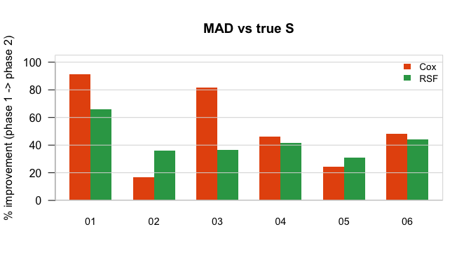
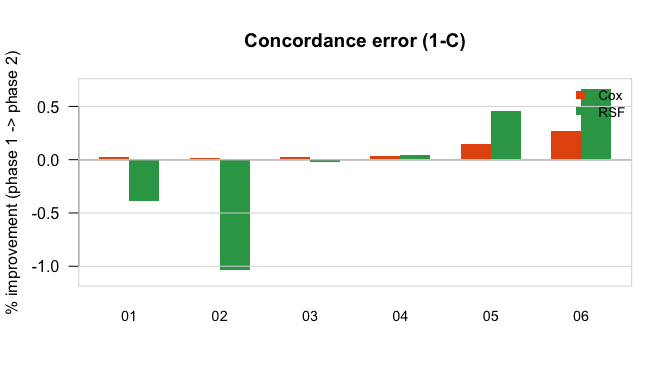
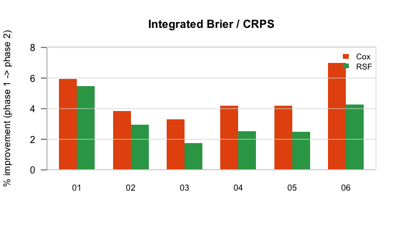
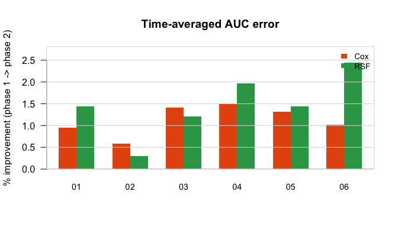

Results at a glance
================

Summary of the completed six-experiment refresh, matching the updated
`stage1_main.html` reports. Numerical values are read from the same
saved 100-replication results used by those HTML files, before display
rounding. No models are fitted while generating this summary. For the
DGP definitions, see [the simulation overview](README.md).

## What “phase 1 → phase 2” means

Every simulation fits the *same* entry-time-aware model
(`cox_lt`/`rsf_lt`) on the *same* replication twice:

- **Phase 1**: that model is given an entry vector of all zeros — i.e.
  “pretend nothing is truncated.”
- **Phase 2**: that same model is given the real, observed entry times.

Each comparison is **paired within a model family**: the same observed
sample, seeds, and hyperparameters, with entry information changed at
fitting. Both phases use left-truncated data; setting entry to zero does
not recover subjects excluded before observation. Ordinary and
zero-entry fits were also fitted independently to check their
survival-curve agreement in every replication.

> **Run size:** 100 replications per experiment, **600 total**, with 200
> population test covariates per replication. Each fit uses 5000
> retained training subjects and 500 trees.
>
> **Provenance:** package/source commit 1802cc3, completed 2026-11-07.
> All completed results passed independent zero-entry checks: maximum
> RSF survival-curve difference 0, maximum Cox difference 3.71e-14.

The summary reads only this completed, fingerprinted run. Historical
saved results and earlier HTML copies are preserved under its source
archive. Differences from historical numbers combine our fixes and
upstream changes; they do not isolate the effect of an individual fix.

Every column is **% improvement from supplying the real entry time**
(`(phase1 - phase2) / phase1 * 100`), computed on each metric’s *error*
scale. So for every column alike, positive = entry time helped, negative
= it made that arm/metric worse.

MAD and Brier are lower-is-better as they stand. The two ranking metrics
are converted to errors first so they sit on that same scale: the
C-index column is computed on `1 - C`, and the AUC column on `1 - AUC`.
Read an AUC entry of `2.9%` as *“the AUC error shrank by 2.9%”* — not as
an AUC rising by 2.9 points.

| \# | DGP | MAD Cox | MAD RSF | C-idx Cox | C-idx RSF | CRPS Cox | CRPS RSF | AUC err Cox | AUC err RSF |
|:---|:---|:---|:---|:---|:---|:---|:---|:---|:---|
| 01 | Cox PH (exactly Cox) | 91.39% | 66.01% | 0.03% | -0.38% | 5.96% | 5.48% | 0.95% | 1.45% |
| 02 | Gompertz-shape (PH violation) | 16.66% | 36.23% | 0.01% | -1.03% | 3.84% | 2.93% | 0.58% | 0.30% |
| 03 | RIST Sc.1 (exactly Cox) | 81.53% | 36.42% | 0.03% | -0.02% | 3.29% | 1.74% | 1.42% | 1.20% |
| 04 | RIST Sc.2 (nonlinear link) | 46.30% | 41.45% | 0.03% | 0.04% | 4.20% | 2.51% | 1.51% | 1.96% |
| 05 | RIST Sc.3 (Gamma, PH violation) | 24.46% | 31.05% | 0.15% | 0.46% | 4.20% | 2.49% | 1.32% | 1.45% |
| 06 | RIST Sc.4 (Lognormal, PH violation) | 48.43% | 44.11% | 0.27% | 0.66% | 7.00% | 4.29% | 1.02% | 2.45% |

Curve accuracy improves in all six scenarios for both model families.
The concordance result is mixed: RSF concordance error increases in
Scenarios 1–3; the small changes in Scenarios 3–4 have paired
descriptive intervals that include zero. In Scenario 2, the RSF
concordance deterioration occurs in every replication. A smaller ranking
change does not imply a smaller survival-curve improvement.

MAD compares unconditioned predictions with source-population survival
truth on independent test covariates. Concordance, CRPS, and AUC use
training outcomes: RSF contributes OOB curves, whereas Cox contributes
in-sample curves. Brier/CRPS and AUC describe entered subjects using
pooled delayed-entry Kaplan–Meier censoring weights. These scores assess
different targets, and the pooled model’s common-censoring-hazard
assumption is stronger than conditional independence given covariates
and entry. The AUC construction is our project extension, rather than an
estimator prescribed by the professor’s outline.

CRPS is the **unnormalized time integral** of the Brier curve; its raw
values depend on the scenario’s evaluation horizon. Absolute paired
phase shifts, descriptive intervals, and replication counts are in [the
numerical summary](reruns/2026-11-06-1802cc3/summary.csv). There,
`paired_shift` is phase 2 minus phase 1 (negative favors entry-aware
fitting); the percentage-reduction table above uses the opposite
direction so positive means improvement.

## By metric

Same numbers as the table above, as 4 small multiples (one axis each —
MAD, C-idx, CRPS, and AUC err live on very different scales, so one
shared axis would be misleading). The zero line is the reference: bars
crossing below it are where entry time made that arm/metric *worse* — in
this run, C-idx RSF.

<!-- -->

<!-- -->

<!-- -->

<!-- -->

## Detailed reports

| Scenario | DGP | Report |
|:---|:---|:---|
| 01 | Cox PH (exactly Cox) | <a href="01_cox_random_forerst_lt/stage1_main.html">HTML</a> |
| 02 | Gompertz-shape (PH violation) | <a href="02_flexihaz_gompertz_lt/stage1_main.html">HTML</a> |
| 03 | RIST Sc.1 (exactly Cox) | <a href="03_rist_scenario1_lt/stage1_main.html">HTML</a> |
| 04 | RIST Sc.2 (nonlinear link) | <a href="04_rist_scenario2_lt/stage1_main.html">HTML</a> |
| 05 | RIST Sc.3 (Gamma, PH violation) | <a href="05_rist_scenario3_lt/stage1_main.html">HTML</a> |
| 06 | RIST Sc.4 (Lognormal, PH violation) | <a href="06_rist_scenario4_lt/stage1_main.html">HTML</a> |

These HTML reports use the same completed result objects as this
summary. The result objects are stored under
`reruns/2026-11-06-1802cc3/results/<scenario>/results_phases.rds`. Each
report also shows AUC over time; a single time average can flatten
differences concentrated in one interval of follow-up. The [Hebrew
summary](../docs/summary_hebrew.md) gives a short explanation of the
results and remaining scope.
